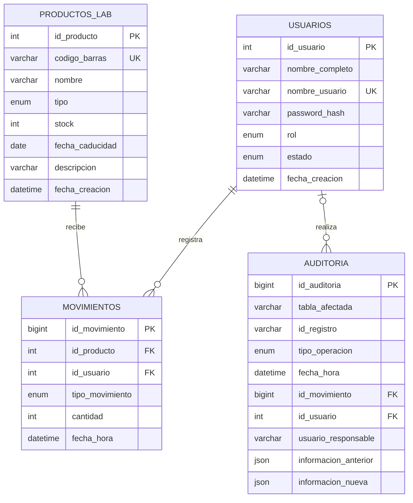

# Modelo y diccionario de datos

## Diagrama entidad-relacion

## Relaciones y reglas

- Un producto puede tener muchos movimientos; cada movimiento corresponde a un producto.
- Un usuario puede registrar muchos movimientos; cada movimiento guarda a su responsable.
- Auditoria conserva cambios a productos. El usuario puede quedar nulo si su cuenta se elimina en una futura extension; el texto `usuario_responsable` conserva la identidad registrada.
- Cuando el cambio auditado es un ajuste de existencias, `id_movimiento` enlaza el evento de auditoria con el movimiento que lo causo.
- Los productos no se eliminan si ya tienen movimientos. El historial de movimientos no se borra por eliminar un producto.
- El codigo de barras es obligatorio y unico. El stock nunca puede ser negativo. La cantidad de cada movimiento debe ser positiva.
- Una entrada aumenta el stock y una salida lo disminuye. El trigger `ai_movimientos_actualizar_stock` aplica el cambio; el procedimiento `sp_registrar_movimiento` coordina el registro y su confirmacion o rollback.

## Diccionario de datos

### `usuarios`

| Campo | Tipo | Nulo | Regla / uso |
|---|---|---:|---|
| `id_usuario` | INT | No | Clave primaria autoincremental. |
| `nombre_completo` | VARCHAR(120) | No | Nombre que identifica al usuario en movimientos. |
| `nombre_usuario` | VARCHAR(50) | No | Identificador de inicio de sesion, unico y no vacio. |
| `password_hash` | VARCHAR(255) | No | Hash con sal; nunca guardar contrasena en texto plano. |
| `rol` | ENUM | No | `admin`, `operador` o `consulta`. |
| `estado` | ENUM | No | `activo` o `inactivo`; solo las cuentas activas deben iniciar sesion. |
| `fecha_creacion` | DATETIME | No | Fecha de alta, por defecto la fecha/hora del motor. |

### `productos_lab`

| Campo | Tipo | Nulo | Regla / uso |
|---|---|---:|---|
| `id_producto` | INT | No | Clave primaria autoincremental. |
| `codigo_barras` | VARCHAR(64) | No | Codigo leido por el lector; unico y no vacio. |
| `nombre` | VARCHAR(120) | No | Nombre del reactivo o material; no vacio. |
| `tipo` | ENUM | No | `reactivo` o `material`. |
| `stock` | INT | No | Existencia actual, con valor minimo cero. |
| `fecha_caducidad` | DATE | Si | Fecha de caducidad de reactivos; puede ser nula para materiales sin caducidad. |
| `descripcion` | VARCHAR(255) | Si | Presentacion u observacion breve. |
| `fecha_creacion` | DATETIME | No | Fecha de alta. |

### `movimientos`

| Campo | Tipo | Nulo | Regla / uso |
|---|---|---:|---|
| `id_movimiento` | BIGINT | No | Clave primaria autoincremental. |
| `id_producto` | INT | No | Clave foranea a `productos_lab`; no se permite borrar productos con historial. |
| `id_usuario` | INT | No | Clave foranea al responsable en `usuarios`. |
| `tipo_movimiento` | ENUM | No | `entrada` o `salida`. |
| `cantidad` | INT | No | Debe ser mayor que cero. |
| `fecha_hora` | DATETIME | No | Momento del movimiento, por defecto la hora del motor. |

### `auditoria`

| Campo | Tipo | Nulo | Regla / uso |
|---|---|---:|---|
| `id_auditoria` | BIGINT | No | Identificador del evento de auditoria. |
| `tabla_afectada` | VARCHAR(64) | No | Tabla que fue modificada. |
| `id_registro` | VARCHAR(64) | No | Clave del registro afectado, guardada como texto para reutilizarla. |
| `tipo_operacion` | ENUM | No | `INSERT`, `UPDATE` o `DELETE`. |
| `fecha_hora` | DATETIME | No | Momento del evento. |
| `id_movimiento` | BIGINT | Si | Movimiento que provoco el cambio; nulo para cambios de producto no asociados a un movimiento. |
| `id_usuario` | INT | Si | Usuario de la aplicacion si la operacion lo proporciona. |
| `usuario_responsable` | VARCHAR(120) | No | Nombre de usuario de la aplicacion o cuenta MySQL que ejecuto el cambio. |
| `informacion_anterior` | JSON | Si | Estado previo para actualizacion/eliminacion. |
| `informacion_nueva` | JSON | Si | Estado nuevo para insercion/actualizacion. |

## Objetos programados incluidos

| Tipo | Objeto | Uso |
|---|---|---|
| Funcion | `fn_dias_para_caducar` | Calcula dias entre hoy y una caducidad. |
| Funcion | `fn_hay_existencia` | Indica si el producto tiene stock. |
| Procedimiento | `sp_buscar_producto_codigo` | Busca un producto por codigo de barras. |
| Procedimiento | `sp_obtener_usuario_login` | Obtiene los datos necesarios para verificar el inicio de sesion. |
| Procedimiento | `sp_registrar_producto` | Registra producto y devuelve su identificador con `OUT`. |
| Procedimiento | `sp_actualizar_producto` | Actualiza datos descriptivos sin permitir modificar el stock directamente. |
| Procedimiento | `sp_registrar_movimiento` | Registra entrada/salida en una transaccion y devuelve movimiento y stock resultante. |
| Procedimiento | `sp_historial_movimientos` | Consulta movimientos de un producto o todos los productos. |
| Vista | `vw_inventario_resumen` | Usa ambas funciones para presentar existencia y estado de caducidad. |
| Triggers de validacion | `bi_productos_lab_validar`, `bu_productos_lab_validar`, `bi_movimientos_validar` | Impiden codigos/nombres vacios, stock negativo, cantidades invalidas y salidas mayores a existencia. |
| Trigger de inventario | `ai_movimientos_actualizar_stock` | Actualiza existencias cada vez que se inserta un movimiento. |
| Triggers de auditoria | `ai_productos_lab_auditar`, `au_productos_lab_auditar`, `ad_productos_lab_auditar` | Registran automaticamente altas, cambios y eliminaciones de productos. |
